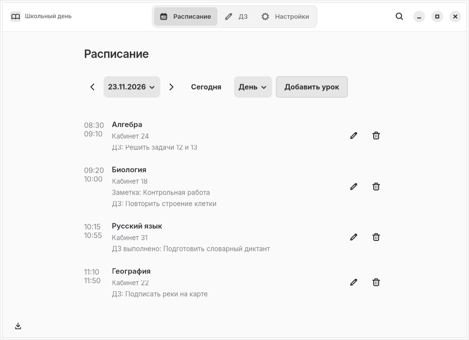
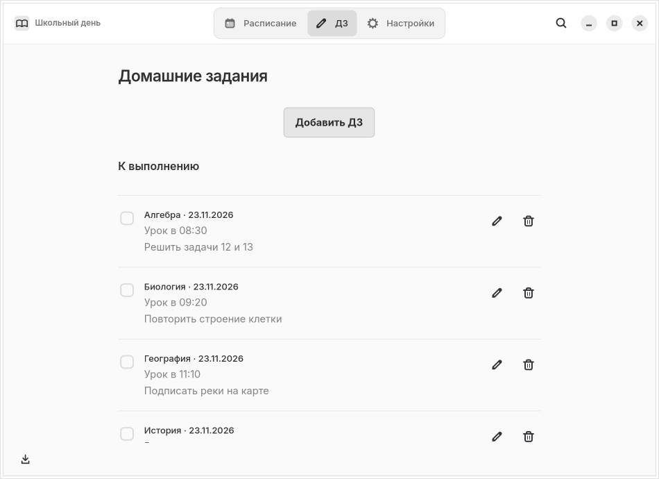
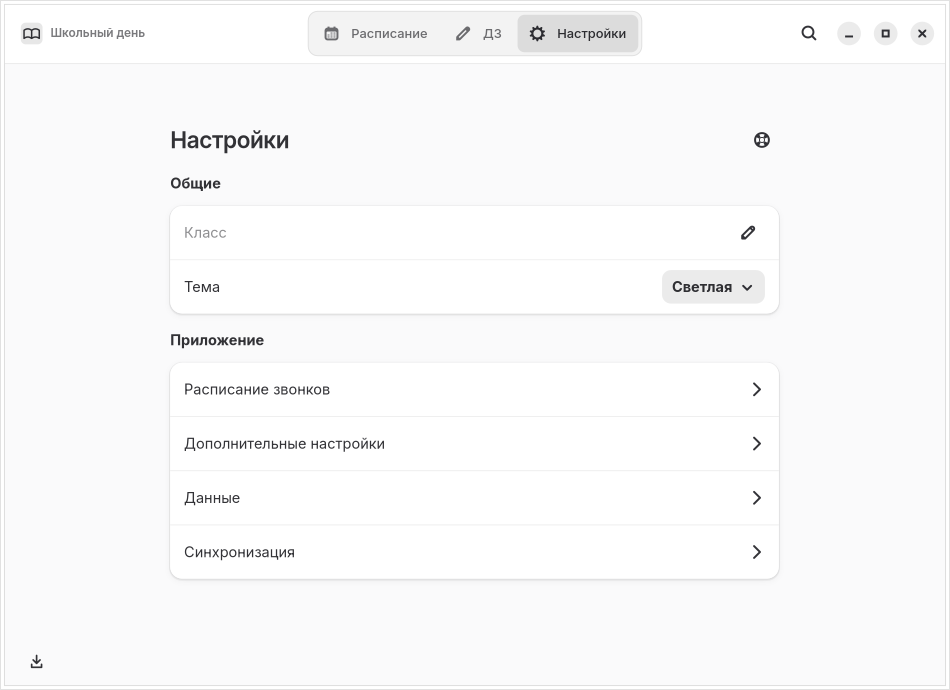
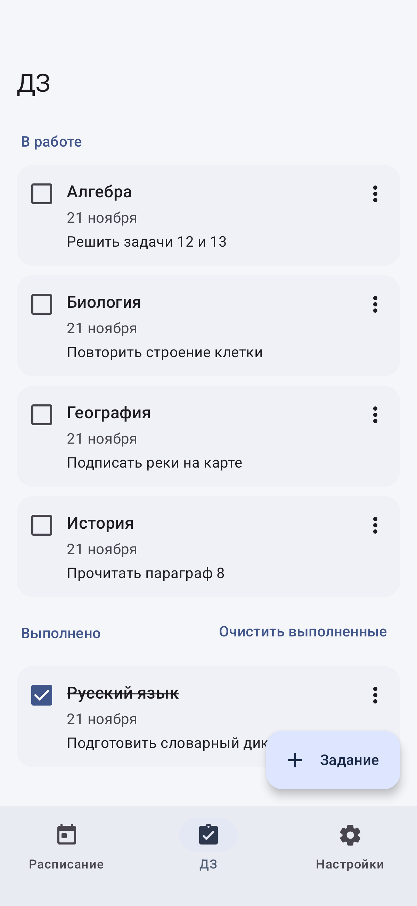

# Школьный день

Бесплатное приложение для расписания уроков и домашних заданий на Windows, Linux и Android. Расписание и ДЗ автоматически синхронизируются между компьютером и телефоном в одной локальной сети.

Ещё скриншоты

  
  

## Установка

- **Windows 10/11 x64** · [Установщик](https://github.com/sqeezy-53/school-day/releases/latest)
- **Linux x86-64 с Flatpak** · [Выпуски Flatpak](https://github.com/sqeezy-53/school-day-flatpak/releases) · [Пакет 0.6.2](https://github.com/sqeezy-53/school-day/releases/download/v0.6.2/school-day-0.6.2-x86_64.flatpak)
- **Android 8.0 и новее** · [Выпуски Android](https://github.com/sqeezy-53/school-day-android/releases)

Для ПК ориентир по памяти 4 ГБ, процессор x86-64 с двумя ядрами.

## Участие в проекте

Нашли ошибку или хотите предложить улучшение?
Создайте [Issue](https://github.com/sqeezy-53/school-day/issues).

Хотите помочь с разработкой? Отправьте Pull Request.

### Лицензия

Проект распространяется по лицензии GPL-3.0.
