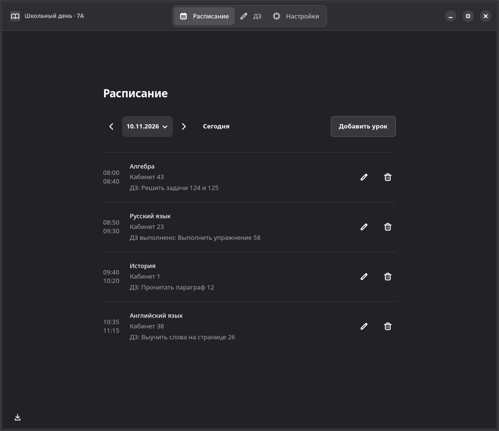
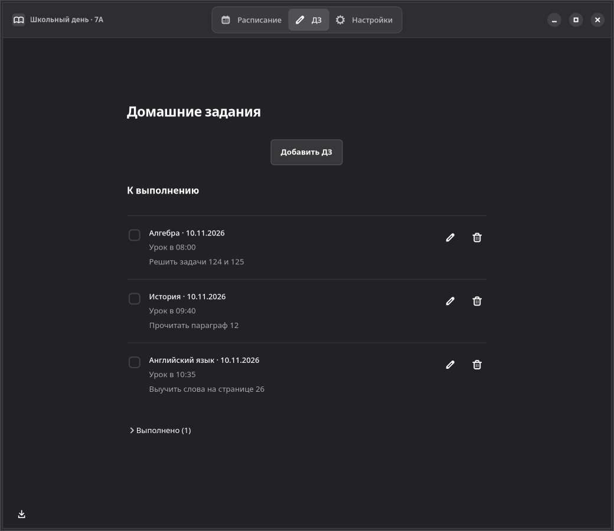
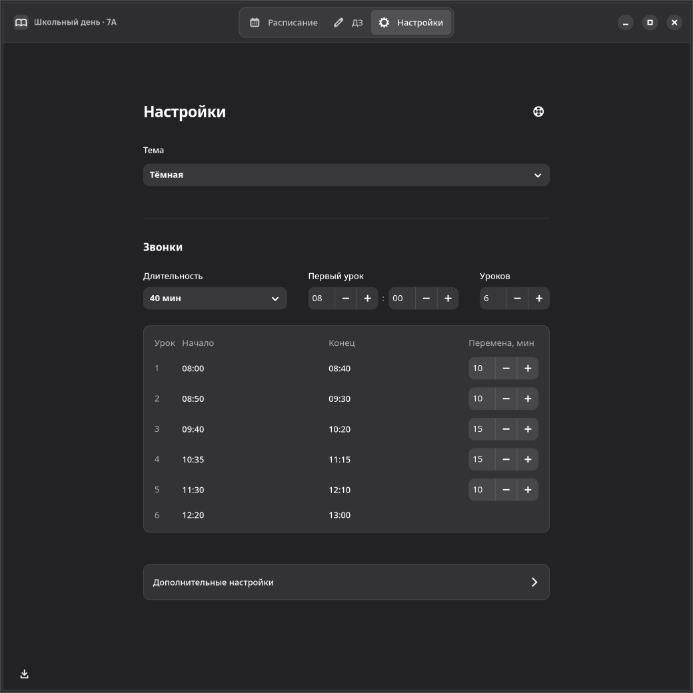

# Школьный день

Бесплатная программа с открытым исходным кодом для управления расписанием уроков и домашними заданиями.



<details>
<summary>Ещё скриншоты</summary>





</details>


## Установка

**Windows x64:** [скачать установщик](https://github.com/sqeezy-53/school-day/releases/download/v0.5.1/school-day-0.5.1-windows-x64-setup.exe).

**Linux x86_64:** установите [Flatpak](https://flathub.org/en/setup) и [скачайте пакет](https://github.com/sqeezy-53/school-day/releases/download/v0.5.1/school-day-0.5.1-x86_64.flatpak).

```sh
flatpak install --user ./school-day-0.5.1-x86_64.flatpak
flatpak run io.github.sqeezy_53.school-day
```


## Участие в проекте

Нашли ошибку или хотите предложить улучшение?
Создайте [Issue](https://github.com/sqeezy-53/school-day/issues).

Хотите помочь с разработкой? Отправьте Pull Request.

### Лицензия

Проект распространяется по лицензии GPL-3.0.
