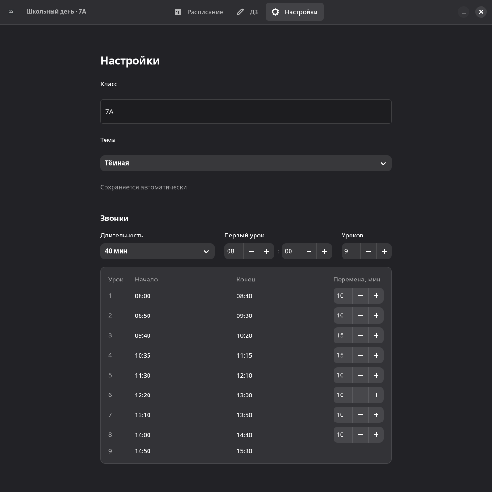

# Школьный день

Расписание уроков и домашние задания для Linux и Windows.


<details>
<summary>Ещё скриншоты</summary>




</details>

## Установка

**Windows x64:** [скачать установщик](https://github.com/sqeezy-53/school-day/releases/download/v0.4.0/school-day-0.4.0-windows-x64-setup.exe).

**Linux x86_64:** установите [Flatpak](https://flathub.org/en/setup) и [скачайте пакет](https://github.com/sqeezy-53/school-day/releases/download/v0.4.0/school-day-0.4.0-x86_64.flatpak).

```sh
flatpak install --user ./school-day-0.4.0-x86_64.flatpak
flatpak run io.github.sqeezy_53.school-day
```
